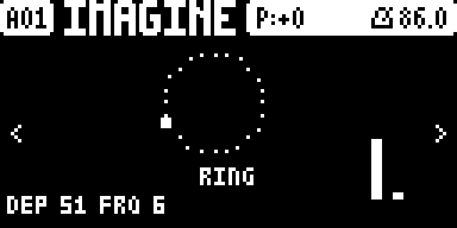
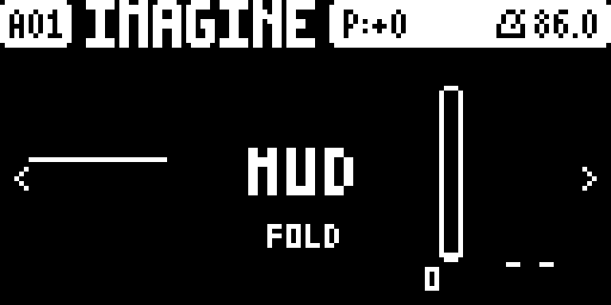
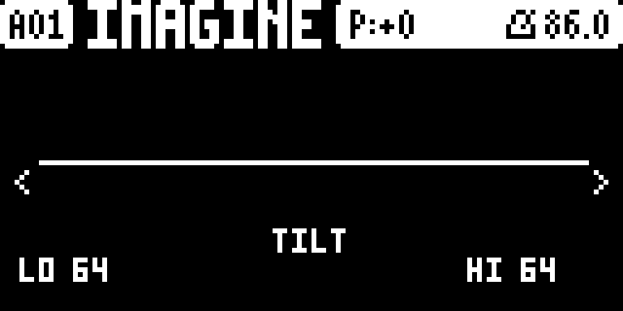
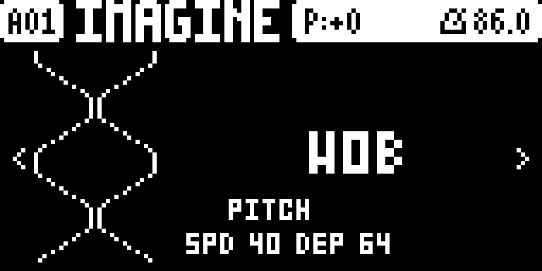
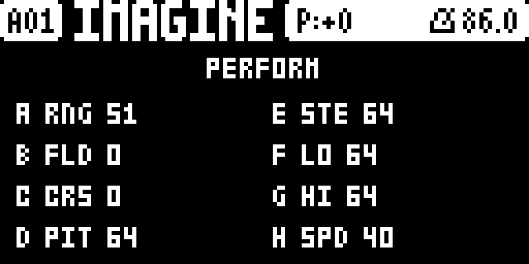

# Tone+FX — development source

**A master effect suite for the Digitone mk1 / Digitone Keys (OS 1.43).**

> This is the **development/source** repo (remote still named `RingTone`). The
> **release** repo — built `.elemod`s, docs and packaged releases — is
> [Tone+FX](https://github.com/DigiAlchemydsp/Tone-FX/releases). **Download the
> latest release from
> [github.com/DigiAlchemydsp/Tone-FX/releases](https://github.com/DigiAlchemydsp/Tone-FX/releases).**



Unofficial, community-made [elekloader](https://github.com/irpina/elekloader)
mods for the **Elektron Digitone mk1 / Digitone Keys, OS 1.43**.

## What it is

RingTone is a **set of elekloader mods (`.elemod`) that install together**. They
process the **master mix on the Digitone's main CPU** — the same stage the
firmware runs its own effects on: after the eight FM voices have been mixed and
before that mix is handed to the analog outputs and to the USB stream. So
**every output carries them**. The FM voices themselves run on the Digitone's
**second CPU**, which these mods do not touch; they only process the mixed
audio.

The master chain is **ring → EQ → crush → fold → wave → meter**:

| mod | stage | what |
|---|---|---|
| `digiring` | **ring** | a sine carrier multiplies the mix — a tremolo at a low rate, a ring at an audio rate |
| `digieq` | **EQ** | a one-pole low/high split (a low-shelf / high-shelf) |
| `digicrush` | **crush** | Crunch / Redux: bit-reduce (BITS), sample-rate hold (SR) or a hard-clip drive (CRUNCH) |
| `digifold` | **fold** | a triangle wavefolder with CLEAN/MUD/DIST/TRSH fold modes + an internal overdrive |
| `digiwave` | **wave** | one modulation engine, two pages: **PITCH** (WOB wobble, SHFT shift) and **STEREO** (FLAN flanger, PAN autopan, WIDE width) |
| `digimeter` | **meter** | L/R peak bars, drawn on the DIGI FOLD page |
| `digictl` | **pages** | the eleven master pages (FUNC+LFO) that edit the FX: RING / FOLD / TILT / CRUSH / PITCH / STEREO / PERFORM plus the four macro pages **WASH / RADIO / DESTROY / SPACE**; the PERFORM page's trigs are momentary performance pads |

`digictl` requires the FX mods, so **install them as a set**: build with
`core-dn1` plus all the suite mods.

> Unofficial and unsupported. Not affiliated with, endorsed by or supported by
> Elektron. Flashing modified firmware is at your own risk. Read
> [`releases/README.md`](releases/README.md) first.

## Use

The pages live on the master page tree: **FUNC + LFO** opens it. Our pages are
split into **two trees**, navigated with **LEFT / RIGHT** (or the on-screen `<`
`>` arrows):

- **FX tree** (play order): **FOLD - CRUSH - RING - STEREO - PITCH - TILT**.
- **PERFORM + macros**, reached with **UP** (UP again returns to the FX page you
  left): **PERFORM - WASH - RADIO - DESTROY - SPACE**.

The stock top status bar stays above every page. PAGE keeps its stock meaning;
no stock key or encoder is taken. A page whose section is off draws a framed
**OFF** box; a page driven by a macro page draws a **MACRO** box (top-right).
Each FX page centres its mode name over the page title and shows a depth slider
(and a rate slider where it applies) in the rightmost third. **H** toggles the
output meter on every FX page, and **FUNC + an encoder turn snaps that
parameter to 0 % / 100 %**.

- **RING** — **A** on/off, **E** depth, **F** frequency, **H** meter. A centred
  ring animation, the values bottom-left.
- **FOLD** — **A** on/off, **D** fold type, **E** amount, **H** meter. The
  spiral (collapses to a line at 0), the big mode name over the title.
- **TILT** — **A** on/off, **E** low shelf, **G** high shelf, **H** meter. A
  bent low/high response curve.
- **CRUSH** — **A** on/off, **D** mode (BITS/**REDUX**/CRUNCH), **E** amount,
  **F** tune, **H** meter. A scrolling waveform that is quantised / held /
  clipped by the mode.
- **PITCH** — **A** on/off, **D** mode (WOB/SHFT), **E** speed, **F** depth,
  **G** mix (dry/wet), **H** meter. Two vertical lines that wobble and intertwine.
- **STEREO** — **A** on/off, **B** feedback, **D** mode (FLAN/PAN/WIDE),
  **E** speed, **F** depth, **G** mix, **H** meter. A horizontal line that
  ripples (FLAN), splits (PAN) or spreads (WIDE).
- **PERFORM** — a static page (no animation). **A** ring depth, **B** fold
  amount, **C** crush amount, **D** WAVE pitch depth, **E** WAVE stereo depth,
  **F** EQ low, **G** EQ high, **H** WAVE speed. The 16 trigs are momentary
  performance pads, one block per engine (`1 2 9 10` ring, `3 4` fold, `11 12`
  crush, `5 6 13 14` pitch, `7 8 15 16` stereo): hold a pad and the engine turns
  on and its depth ramps up; release restores the saved pattern value.
- **WASH / RADIO / DESTROY / SPACE** — four one-slider macro pages (one vertical
  slider on the right, **A** on/off, **B–H** amount, + a per-page graphic). Each
  drives a bundle of engines while on and restores them when off:
  **WASH** = WOB + SRR (CRUSH SR) + EQ tilt; **RADIO** = band cut (EQ) + TRSH
  fold + CRUSH; **DESTROY** = fold + bits + ring; **SPACE** = WAVE stereo width.

The **fold type** is a continuous 0–127 knob spread over four modes — CLEAN
(36% fold), MUD (full fold), DIST (36% fold + hard-clip overdrive) and TRSH
(full fold + overdrive) — interpolated between modes and capped at CLEAN/TRSH.

Every parameter is **0–127** and moves **one step per notch**, the stock
convention (EQ LOW/HIGH show 0–127 with 64 = flat). The FX also respond to
**incoming MIDI CC** (a set of CC numbers the stock DN does not use), so they can
be played/sequenced from an external controller; see
[`docs/MIDI-CC.md`](docs/MIDI-CC.md).

The master effects (EQ, ring, fold) are on by default.

## Pages

Eleven master pages (**FUNC + LFO**; **LEFT/RIGHT** rotates; **UP** opens
PERFORM from any of the other pages). Each FX page has a frameless animated
graphic in the leftmost third that collapses to a line when the effect is at
neutral; PERFORM is static and the four macros each show one slider + a graphic.
Per-pattern settings are stored in `"DGX1"` v10 (28 params) + `"DGX2"` v2 (the
macros).

| RING | FOLD | TILT |
|---|---|---|
|  |  |  |

| CRUSH | PITCH | STEREO | PERFORM |
|---|---|---|---|
|  |  |  |  |

## CPU footprint

Everything runs on the Digitone's **main CPU (Core A)**; the FM DSP (Core B) is
untouched. Approximate instructions per active stereo frame (32 frames/block,
1500 blocks/s); a bypassed section costs ~0. Cheapest → heaviest:

| # | block / mode | ≈ insn/frame |
|---|---|---|
| 1 | `digicrush` — BITS | ~10 |
| 2 | `digicrush` — SR | ~12 |
| 3 | `digimeter` | ~15 |
| 4 | `digiwave` — WIDE | ~18 |
| 5 | `digifold` — CLEAN/MUD | ~20 |
| 6 | `digiwave` — PAN | ~24 |
| 7 | `digicrush` — CRUNCH | ~25 |
| 8 | `digiring` | ~28 |
| 9 | `digieq` | ~30 |
| 10 | `digifold` — DIST/TRSH | ~35 |
| 11 | `digiwave` — WOB | ~45 |
| 12 | `digiwave` — FLAN | ~55 |
| 13 | `digiwave` — SHFT | ~75 |

Turn off the pages you are not using; each true-bypasses. Full ledger in
[`docs/OPTIMIZATION.md`](docs/OPTIMIZATION.md).

**Output ceiling:** a final soft limiter keeps the master mix below the 24-bit
full scale (transparent below ~-2.5 dBFS, asymptotic max ~-0.7 dBFS), so a hot
flanger-feedback / pitch-shift / drive setting cannot hard-clip.

## Optimizations (perf-opt, in 3.5p)

A measured CPU / footprint pass, merged from the `perf-opt` worktree. Full ledger:
[`docs/OPTIMIZATION.md`](docs/OPTIMIZATION.md) §9; plan + statuses:
[`docs/PERF-OPT-PLAN.md`](docs/PERF-OPT-PLAN.md). Everything is bit-identical or a
stated trade; nothing changes what the suite does.

| optimization | effect |
|---|---|
| **Direct framebuffer UI drawing** — page graphics write the 1 bpp panel bytes instead of one `DN_FILLRECT` call per pixel/span | 36 call sites → 0; pages pixel-identical; `.run` 26863 → 26707 |
| **Meter gated on visibility** — the per-block peak scan runs only while the FOLD page (its only reader) is up | render worst 99,965 → 99,557 cyc; margin 40.03 → 40.27 % |
| **Hoist block-constant branches** in `digicrush` (BITS dither) and `digifold` (drive) | worst 104,579 → 104,158 cyc; output bit-identical |
| **Store-sync gating** — the per-tick 84-byte compare runs every 8th tick (edits/switches immediate) | −25,867 instructions/s |
| **Shorter WAVE dry line** — `WV_N` 2048 → 1024, landed with the flanger fix | `.bss` delay lines −6.1 KB |

Measured and **rejected** (reverted): caching `dn_out_off()` (it is already an
inline uncached read) and `-O3` (more cycles *and* +21 % code). The **#5 ceiling
gate was landed then reverted** — skipping the limiter with all FX off lets a hot
mix hard-clip. **Parked:** fusing the master passes (#2, ROI), the EMAC
multiplies (#7), `.fast` SRAM (#13, blocked); the block-rate ring LFO (#8) is
unsound as written (audio-rate carrier). Net footprint of this build: `.run
27475`, **`.bss 19446` (−6.1 KB)**, `imports nothing`.

## Layout

```
src/            corea.h, sin256.h  (shared helpers)
mods/<id>/      mod.json + sources + out/<id>-<ver>.elemod
mods/tonefx/    the merged suite mod (format 2; requires the core, no core inside)
releases/       the packaged .elemods + a README (no firmware)
docs/           findings (pattern storage, MIDI CC, parked DSP plans)
DSP.md          DSP reference (addresses, the two CPUs, the FM engine, ...)
LICENSE         GPL-2.0
```

## Getting it

elekloader builds a custom OS **on your machine** from your own stock
`Digitone_and_Digitone_Keys_OS1.43.syx` plus these mods; it never distributes
firmware. Take the `.elemod`s from [`releases/`](releases/) (plus
`core-dn1-2.0a.elemod`), add them in elekloader's window, and build the `.syx`.
See [`releases/README.md`](releases/README.md) for install and recovery.

> **New releases live in [Tone+FX](https://github.com/DigiAlchemydsp/Tone-FX/releases).**
> Get the packaged suite from there; the `releases/` folder here is the older
> RingTone snapshot.

## Building from source

The suite ships as one merged mod, `mods/tonefx/` (it requires the core, which
it does not include). Build it, then patch the core + `tonefx`:

```powershell
$env:PATH = "C:\SysGCC\m68k-elf\bin;" + $env:PATH
$env:ELEKLOADER_CROSS = "m68k-elf-"
$env:PYTHONPATH = "<elekloader checkout>"
$stock = "<your> Digitone_and_Digitone_Keys_OS1.43.syx"
$core  = "<elekloader>\mods\core-dn1\out\core-2.0a.elemod"
python -m elekloader.sdk.build "mods\tonefx" --stock $stock
python -m elekloader.patch --stock $stock --mod $core `
  --mod mods\tonefx\out\tonefx-3.5p.elemod --out custom.syx --version 3.5p
```

The components (`digimeter`, `digieq`, `digiring`, `digifold`, `digictl`) can
still be built and combined individually.

## Status

Current build **`tonefx 3.5r`** (eleven pages: RING / FOLD / TILT / CRUSH /
PITCH / STEREO / PERFORM + the WASH / RADIO / DESTROY / SPACE macros). Tested in
the **digiemu** emulator (boot/settle, `dsp_running=2`; all eleven pages; the
flanger/pitch lines verified independent; the per-pattern store round-trips); the
3.2 line was **stress-tested on two Digitone mk1 units — in parallel and in
series — over synths, drums, vocals and master tracks (including vinyl)**. Done:
pattern-level save/reload (`DGX1` v10 + `DGX2`), stock 0–127 controls, MIDI CC,
one merged `tonefx` mod, the PERFORM page + macros, encoder steps that match
stock, the measured performance pass, and the 3.5p fixes (flanger/pitch link,
FLAN bypass, MIDI-track microtiming). Remaining: a formal headroom measurement
and the tracked follow-ups (see [`HANDOFF.md`](HANDOFF.md) and the release
README's "Known bugs / future fixes").

## Parked / future work (branches + docs; NOT in the release)

The current release (`Tone+FX` 3.5p) is the eleven-page suite (incl. PERFORM +
the macros) + MIDI CC + the performance pass. These are parked for later:

- **Fuse the six master passes** into one loop (`perf-opt` #2) — real CPU back,
  but a six-module refactor whose win is margin-comparable to the landed items;
  plus **EMAC multiplies** (#7) and **`.fast` SRAM** (#13, blocked).
- **Sequencer p-lock automation for the FX params** — branch `tonefx-plock`,
  `docs/PLOCK-AUTOMATION.md` (on the branch): let the internal sequencer
  record/play the DIGI FX params as parameter locks. Prototype works; needs the
  active-page global (the ~1/4-page issue), then a hardware pass.
- **Per-voice filter rewrite + digimachine** — branch `filter-and-digimachine`:
  the Digitakt-style smoothed/fractional comb with four knobs, and the wavetable
  machine. Not part of Tone+FX.
- **LFO destinations** — `docs/MODULATION-AND-ROUTING.md` (parked bridge).
- **Audio-chain reroute (pre-FX)** — same doc.
- **Core B per-voice filter** — parked with the filter branch.
- **FAST AUDIO on the DN** — `docs/FAST-AUDIO-DN.md`.

## Testing

```powershell
python tests/digiemu_fx_screenshots.py --fw <dn1-...>               # RING / FOLD / TILT screenshots
python tests/digiemu_nav.py --fw <dn1-...>                          # LEFT/RIGHT page navigation
python tests/digiemu_pattern_store.py --fw <dn1-...>                # per-pattern settings (v10 + DGX2)
python tests/digiemu_midi_cc.py --fw <dn1-...> --map <syx.map.json> # MIDI CC hook
python tests/_diag_perf.py --fw <dn1-...>                           # PERFORM page, UP nav, encoder->store
python tests/_diag_perf_live.py --fw <dn1-...>                      # live SSI: the engine-split pads
```

(The `digiemu_*` tests need the patched-Unicorn venv; `--fw` is a firmware the
app built from `core-dn1` + the mods. `_diag_perf.py` reads the patch's
`*.syx.map.json` for symbol addresses.)

## Licence

Our own code and docs: **GPL-2.0-or-later** ([LICENSE](LICENSE)). This does not
cover the manufacturer's firmware, which is never distributed here.
